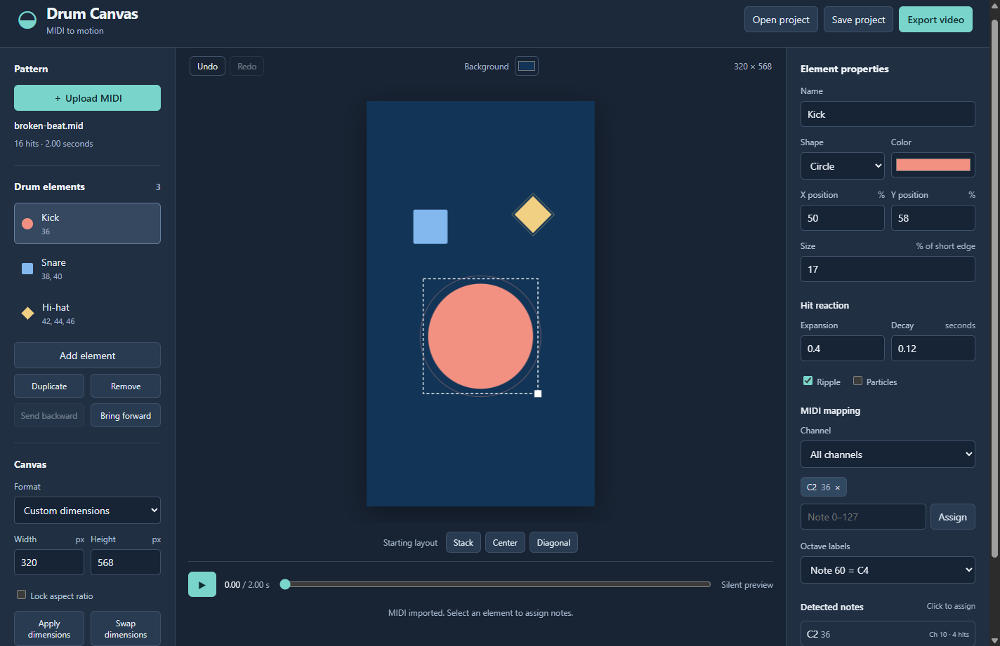
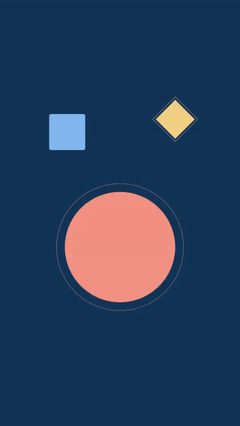
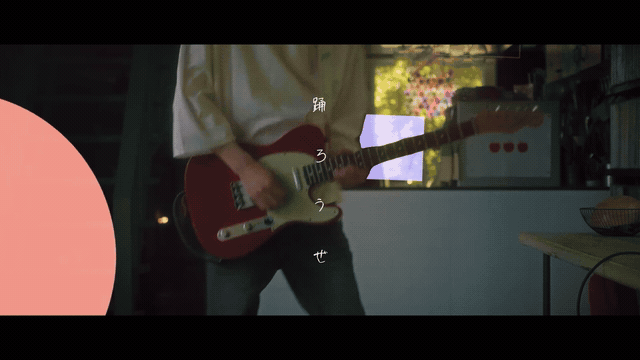

# Drum Canvas

A local MIDI-to-video editor. Map MIDI notes to drum elements, arrange and style their reactive shapes, then export an MP4 for your video editor.



## Install on Windows

**Windows 10/11, 64-bit.** Everything is included—no terminal, Node.js, or FFmpeg setup.

1. [Download the Windows installer](https://github.com/VanKyle00/drum-pattern-visualizer/releases/download/v1.1.0/Drum-Canvas-Setup-1.1.0-x64.exe) (126 MB).
2. Open the downloaded `.exe` and follow the setup steps.
3. Launch **Drum Canvas** from your desktop or Start menu.

Prefer no installation? [Download the portable app](https://github.com/VanKyle00/drum-pattern-visualizer/releases/download/v1.1.0/Drum-Canvas-Portable-1.1.0-x64.exe) and double-click it. The first launch may take a moment to unpack.

This release is unsigned, so Windows may show a publisher warning. You can also find downloads on the [releases page](https://github.com/VanKyle00/drum-pattern-visualizer/releases).

## Make your first video

1. Click **Upload MIDI** and select a `.mid` file. Try the included [example drum pattern](public/examples/broken-beat.mid).
2. Select each drum element and assign its MIDI notes. Drag the shapes into place, then customize their size, shape, and color.
3. Choose the canvas dimensions and **Background** color. Press **Play** to preview.
4. Click **Export video** → **Render MP4** → **Download MP4**, then choose where to save it.

The video is silent—add your drum audio in your video editor. Use **Save project** before closing so you can continue later; projects are not autosaved.

### See the motion

This looping preview comes from an actual exported video:



### Usage example

Drum Canvas visuals composited into a music video. This silent, looping GIF shows an example of using the exported animation in a finished edit.



## What you can customize

| Control | What it does |
| --- | --- |
| MIDI mapping | Assign notes and channels to kick, snare, hi-hat, or your own custom drums. |
| Shape and layout | Drag and resize elements; choose circles, squares, diamonds, or triangles. |
| Motion and color | Change fill colors, hit expansion, decay, ripples, and particles. |
| Canvas | Choose portrait, landscape, square, or custom dimensions and a background color. |
| Video export | Save an H.264 MP4 at 30 or 60 fps, ready for further editing. |

Everything runs locally. The desktop app remembers its window size and position and uses Windows Save As dialogs for videos and projects.

<details>
<summary>For developers: run from source in a browser</summary>

Install Node.js 22.12+ (Node 24 recommended) and FFmpeg with both `ffmpeg` and `ffprobe` on PATH. From this project folder:

```powershell
npm.cmd install
npx.cmd playwright install chromium
npm.cmd run build
npm.cmd start
```

Open **http://127.0.0.1:4173**. Keep the terminal running while editing and exporting. For development, use `npm.cmd run dev` instead. The application binds only to the local computer; it does not upload MIDI or projects to a service.

A small example pattern is included at [public/examples/broken-beat.mid](public/examples/broken-beat.mid) for trying the editor.

If FFmpeg is in a custom location:

```powershell
$env:FFMPEG_PATH = 'C:\Tools\ffmpeg\bin\ffmpeg.exe'
npm.cmd start
```

Use `$env:PORT = '4174'` before launching to choose a different port.

</details>

## Editing

1. **Upload MIDI** (.mid/.midi, formats 0 and 1). Timing follows the MIDI tempo map. SMPTE timing and format 2 are rejected with an explanation.
2. Select an element from the list or directly on the canvas. Assign one or more note numbers, optionally restricted to a channel. Click detected notes to assign them; click an assigned note's × to remove it.
3. **Add element** creates a custom drum. Rename it and choose its circle, square, diamond or triangle shape, fill color, size, expansion, decay, ripple and particles.
4. Drag shapes to move them. Drag the selected shape's lower-right handle to resize. Numeric positions are percentages of the canvas; size is the base radius as a percentage of its shorter edge. Velocity controls hit intensity.
5. Set a canvas preset or custom width and height, then **Apply dimensions**. MP4 supports even integer dimensions from 64 to 4096 per side. Aspect locking derives the other dimension exactly; if it yields an invalid dimension, choose another width or unlock the ratio. Shapes retain their proportions.
6. Use **Play**, pause or scrub to inspect motion. Preview and output are silent: add your original drum audio in your video editor.

Note names differ between DAWs. **Octave labels** selects whether note 60 is shown as C3, C4 or C5. The MIDI number is always authoritative, and changing labels never changes a mapping. Channels are numbered 1–16.

**Undo/Redo** includes element edits, layouts, imports and canvas changes. Ctrl/Cmd+Z and Ctrl/Cmd+Shift+Z work outside input fields; Space toggles playback. Starting layouts reposition only the original kick/snare/hi-hat elements and preserve custom elements and all mappings.

## Save projects

**Save project** downloads a `.drum.json` file containing the MIDI data and all settings. **Open project** restores it without needing the original MIDI file. Save before closing or refreshing the page; there is no autosave. Invalid imports leave the current project intact.

## Export

Choose **Export video**, set the source range, repeats and 30 or 60 fps, then **Render MP4**. Resolution matches the canvas exactly. Rendering runs offline from an immutable project snapshot, so editing during export does not change it. Each repeat restarts at the range start; a range can extend beyond the MIDI end to include a visual tail.

The result is an H.264 MP4 with a solid background and no audio. Canvas guides and selection handles are excluded. Transparent video is not included in this version. A render may last up to ten minutes; only one export runs at a time. Large frames and long clips take longer to render.

When ready, **Download MP4** saves through your browser's download folder or Save As dialog. Names include a unique export ID. You can close and reopen the export dialog while a job runs. Cancelling or failing an export does not publish a partial file.

The desktop app keeps render files in `%APPDATA%\Drum Canvas\render-jobs`; the browser version uses `.render-jobs/<job-id>/video.mp4` in the project directory. Download links work until the app or local server restarts; files remain on disk afterwards. You can remove completed job folders when the app is closed and you have saved the videos you need. These files are not tracked by Git.

## Verification

```powershell
npm.cmd test
npm.cmd run build
npm.cmd run test:e2e
```

Unit tests cover project validation, MIDI tempo conversion, note mapping, deterministic animation and undo history. Browser tests exercise the editor, saved projects, real MP4 output via FFmpeg/ffprobe, frame equivalence, cancellation and render failures.

## Structure

- `src/core`: project model, MIDI timing, shared scene evaluation and drawing.
- `src/editor`: canvas interaction, inspector, transport, export dialog and settings.
- `server`: loopback API, validated render snapshots and encoder jobs.
- `tests` and `e2e`: unit and browser tests, using generated MIDI fixtures.
